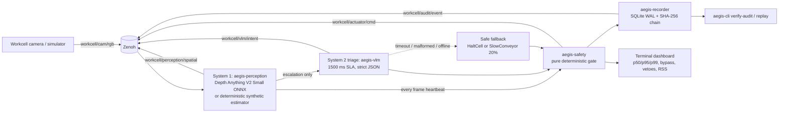

# AegisLoop-RS

**Closed-loop spatial edge vision and deterministic robotics safety runtime, in Rust.**

A dual-frequency control architecture for Physical AI: a fast, bounded System 1 spatial loop measures clearance on every frame; a slow, asynchronous System 2 VLM proposes semantic recovery actions only on escalation; a pure, zero-panic safety envelope is the *only* component allowed to emit an actuator command. Every decision is written to a tamper-evident SQLite WAL ledger and can be replayed bit-for-bit.

[](https://github.com/prasanth-chadaram/AegisLoop-RS/actions/workflows/ci.yml)

---

## 1. Problem statement

By 2028, collaborative cells will run vision-language models next to hard real-time motion control. Three failure modes dominate:

1. **Latency inversion.** A VLM call (hundreds of milliseconds) cannot sit inside a 10 ms perception loop. System 1 must keep running when System 2 stalls.
2. **Semantic unsafety.** An LLM/VLM can propose plausible but physically impossible actions (a `+900 mm` regrasp, an out-of-range conveyor speed). Neural output must never reach hardware unchecked.
3. **Unauditable autonomy.** Without a chained, replayable record, an incident cannot be reconstructed or proved deterministic.

AegisLoop-RS answers with three hard boundaries:

- **Frequency separation:** System 1 runs every frame; System 2 is triggered only above an escalation threshold (typically >80% bypass).
- **Deterministic envelope:** a pure state machine enforces geofence, proximity E-stop, watchdog, latency SLA, and rate/jerk limits. Every proposal is logged `APPROVED`, `CLAMPED`, or `VETOED` with exact rule IDs.
- **Evidence chain:** SHA-256 chained flight recorder over `(sensor_hash, spatial_state, vlm_proposal, safety_decision, actuator_cmd)`; replay re-evaluates through a fresh safety engine.

All transport is typed Zenoh. All runtime paths avoid `unwrap()`. Target host: Intel i3-1005G1 (2C/4T), 8 GB RAM, CPU-only, peak RSS budget < 2.0 GB.

---

## 2. Architecture



**Crate map**

| Crate | Role |
| --- | --- |
| `aegis-proto` | Typed Zenoh schemas, hashing helpers, rule IDs, audit records |
| `aegis-perception` | System 1 spatial loop, zone clearance map, bounded ring buffers, optional ONNX backend |
| `aegis-vlm` | System 2 async worker, OpenAI-compatible HTTP backend, strict schema, 1500 ms timeout, safe fallback |
| `aegis-safety` | Pure state machine; final and only actuator gatekeeper |
| `aegis-recorder` | Append-only SQLite WAL ledger, chain verification, deterministic replay |
| `aegis-sim` | Headless four-scenario Zenoh workcell + live runtime + terminal dashboard |
| `aegis-cli` | Single binary: `run`, `sim`, `bench`, `verify-audit`, `replay` |

---

## 3. Zenoh / ROS 2 topic contract

| Topic (Zenoh key expression) | ROS 2 analogue | Payload type | Producer | Consumer |
| --- | --- | --- | --- | --- |
| `workcell/cam/rgb` | `sensor_msgs/Image` + metadata | `RgbFrame` (seq, monotonic ns, frame hash, scene tag, pixels) | simulator / camera bridge | System 1 |
| `workcell/perception/spatial` | custom `SpatialState` | per-zone min/mean depth, intrusion flags, anomaly score | System 1 | System 2 triage, safety, dashboard |
| `workcell/vlm/intent` | custom `VlmProposal` | typed action + confidence + rationale | System 2 / safe fallback | safety, ledger |
| `workcell/actuator/cmd` | `std_msgs`/custom command | verified command + veto metadata + rule IDs | safety only | PLC / actuator bridge, dashboard |
| `workcell/audit/event` | rosbag / diagnostics | SHA-256 chained `AuditEvent` | recorder | `verify-audit`, `replay` |

Action vocabulary (strict serde enum, unknown fields rejected):

`Continue` · `SlowConveyor { speed_pct }` · `DivertPart { bin_id }` · `RegraspOffset { dx_mm, dy_mm, dz_mm }` · `HaltCell { reason }`

### Safety rules

| Rule ID | Invariant | Effect |
| --- | --- | --- |
| `GEO-001` | Regrasp offset beyond hard kinematic limit (`±60 mm`) | `VETOED` + halt |
| `GEO-002` | Regrasp offset inside hard but outside soft limit (`±25 mm`); divert bin outside `1..=8` | `CLAMPED` / `VETOED` |
| `SAF-001` | Human intrusion or critical clearance `< 120 mm` | Hard E-stop, overrides any VLM intent |
| `WD-001` | System 1 heartbeat older than `100 ms` | `HaltCell`, `VETOED` |
| `WD-002` | System 1 inference over `100 ms` SLA | `HaltCell`, `VETOED` |
| `SPD-001/002/003` | Speed range, max `12%` delta and `6%` jerk per transition | `CLAMPED` |
| `LATCH-001` | E-stop stays latched until explicit operator reset | `VETOED` |

---

## 4. Quickstart

```bash
# One command: four-scenario simulation over real Zenoh (no model weights needed)
cargo run --release -- sim

# Inspect and prove the ledger
cargo run --release -- verify-audit aegisloop-audit.db
cargo run --release -- replay aegisloop-audit.db

# CPU benchmark, simulated and real weights
cargo run --release -- bench --frames 2000
./scripts/download_models.sh depth
cargo run --release --features onnx -- bench --frames 200 --real-model

# Live loop: consume external camera frames from workcell/cam/rgb
cargo run --release -- run --endpoint http://127.0.0.1:8081/v1/chat/completions
```

Model weights are **never** committed. `scripts/download_models.sh` resolves `${AEGIS_MODEL_DIR}`, then `/mnt/data/aegisloop-models` (if writable), then `~/.cache/aegisloop-models`:

| Asset | Source | Approx. size |
| --- | --- | --- |
| `depth-anything-v2-small.onnx` (int8 quantized) | `onnx-community/depth-anything-v2-small`, `onnx/model_quantized.onnx` | 27 MB |
| `SmolVLM2-256M-Video-Instruct-Q4_K_M.gguf` | `ggml-org/SmolVLM2-256M-Video-Instruct-GGUF` | 131 MB |
| `mmproj-SmolVLM2-256M-Video-Instruct-f16.gguf` (vision projector) | same GGUF repo | 190 MB |

For real System 2, serve the GGUF with `llama-server` and the projector:

```bash
llama-server -m "$AEGIS_MODEL_DIR/SmolVLM2-256M-Video-Instruct-Q4_K_M.gguf" \
  --mmproj "$AEGIS_MODEL_DIR/mmproj-SmolVLM2-256M-Video-Instruct-f16.gguf" \
  --port 8081 --ctx-size 2048 --threads 2
```

---

## 5. Measured benchmarks

All numbers below were **actually measured** on this host with `--release`; none are estimated or fabricated.

**Host:** Pop!_OS Linux, Intel Core i3-1005G1 (2C/4T), 8 GB RAM, CPU-only. Peak RSS read from `/proc/self/status` `VmHWM`.

| Scenario | Command | Frames | p50 | p95 | p99 | Throughput | VLM bypass | Peak RSS |
| --- | --- | ---: | ---: | ---: | ---: | ---: | ---: | ---: |
| **Simulated** System 1 (synthetic depth) | `bench --frames 2000 --warmup 100` | 2000 | 0.023 ms | 0.042 ms | 0.067 ms | 11,483 FPS | 99.90% | 5.8 MiB |
| **Simulated** full stack (Zenoh + SQLite + mock VLM) | `sim --frames 90 --interval-ms 5` | 90 | 0.034 ms | 0.097 ms | 0.178 ms | interval-limited | 96.67% | 13.4 MiB |
| **Real weights** Depth Anything V2 Small int8 ONNX, CPU | `bench --frames 200 --warmup 20 --real-model` | 200 | 14.909 ms | 18.562 ms | 19.896 ms | 59.6 FPS | 100.00% | 79.1 MiB |
| **Real VLM, production SLA** SmolVLM2 Q4_K_M via llama-server | `sim --frames 12 --real-vlm` (1500 ms SLA) | 12 | 0.049 ms | 0.147 ms | 0.147 ms | interval-limited | 75.00% | 20.2 MiB |
| **Real VLM, relaxed SLA** same endpoint, 8000 ms timeout | `sim --frames 12 --real-vlm --timeout-ms 8000` | 12 | 0.061 ms | 0.189 ms | 0.189 ms | interval-limited | 75.00% | 20.1 MiB |

Full-stack simulation also measured **1.00 ms** from intrusion frame to latched `HaltCell` publication (budget: <50 ms), wrote **90** audit entries, chain verification passed, and replay produced **0 mismatches** (88 approved, 2 vetoed). The simulated paths use the deterministic depth estimator and a mock VLM; they do **not** imply real-model accuracy.

At the **1500 ms production SLA** the real 256M VLM could not answer in time on this CPU: both escalations timed out and were replaced by the deterministic safe fallback (0 accepted / 2 fallbacks) while System 1 continued at ~0.05 ms. With the timeout relaxed to 8000 ms, both responses were accepted with measured VLM latencies of **2385 ms** and **2568 ms** (2 accepted / 0 fallbacks), and the resulting ledger still verified and replayed with 0 mismatches. This is the intended behaviour: semantic recovery is best-effort, the safety envelope is not.

> Real ONNX input is preprocessed to 64×64 NCHW with two intra-op threads. Depth Anything V2 emits *relative* depth; the real backend applies `mm = depth_offset_mm + d * depth_gain_mm` (default `300 + 1500*d` in `--real-model` runs) and must be calibrated per camera before driving proximity thresholds in production. `allow_scene_hints` is forced off for real-model runs so untrusted frame tags can never fabricate an intrusion.

---

## 6. Verification

```text
cargo fmt --all -- --check
cargo clippy --workspace --all-targets -- -D warnings
cargo test --workspace          # 44 tests: 40 unit + 4 cross-crate integration
```

Tests cover: geofence veto, human-proximity override, watchdog expiry, latency SLA, rate/jerk clamping, E-stop latching, NaN rejection, VLM timeout/malformed fallback, strict JSON schema, hash-chain tamper detection, and deterministic replay. No test needs model weights, network, or a Zenoh broker.

CI (`.github/workflows/ci.yml`) runs format, clippy with `-D warnings`, and the full test suite on every push and PR.

---

## 7. Design notes and limits

- The hot path reuses one depth buffer and a fixed-capacity latency ring; frame submission uses `try_send` on a bounded channel and counts drops instead of growing queues.
- `aegis-safety` is pure: no I/O, no allocation in the hot decision path beyond rule vectors, no `unwrap()`; every numeric boundary is finite-checked and saturating.
- E-stop is latched. Only an explicit operator call to `clear_estop()` re-arms the cell; perception or VLM output can never clear it.
- The audit ledger uses `serde_json` with deterministic field order plus length-prefixed domain separation, so replay on another machine reproduces identical hashes.
- `onnx` is an opt-in Cargo feature so default builds and CI stay offline and small.

Licensed under Apache-2.0.
